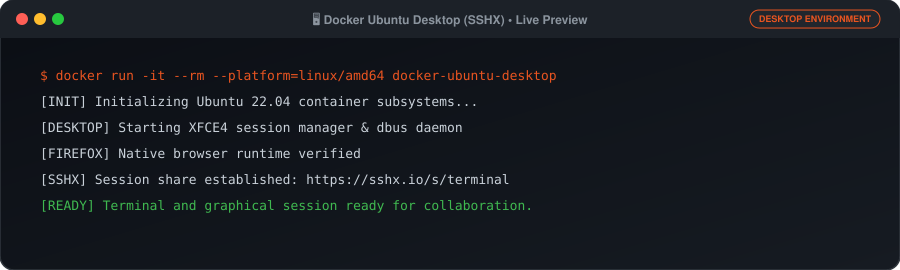
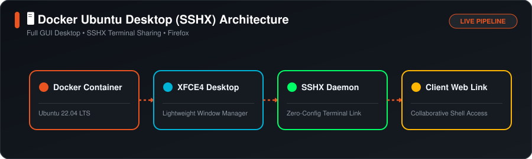

<h1 align="center">🖥️ Docker Ubuntu Desktop (SSHX)</h1>

<p align="center">
  <a href="https://github.com/itzxsahil">
    
  </a>
</p>

<p align="center">
    
</p>

---

## 📸 Project Preview

<p align="center">
  
</p>

---

# 🚀 Overview

A full Ubuntu XFCE4 graphical desktop environment packed into a Docker image featuring instant web-based terminal sharing via SSHX.

---

# 🏗️ System Architecture & Data Flow

<p align="center">
  
</p>

<br>

The Docker container initializes XFCE utilities and connects to the SSHX network, providing a collaborative terminal web URL to anyone with the link.

---

# ✨ Features

✅ **XFCE4 Desktop & Firefox**: Lightweight GUI with complete web browsing capability.\n✅ **Zero-Config SSHX**: Generates a secure collaborative URL on startup.\n✅ **Multi-Arch**: Compatible with standard AMD64 and VPS systems.

---

# 📦 Installation & Quickstart

```bash
docker run -it --rm --platform=linux/amd64 docker-ubuntu-desktop
```\nOpen the generated sharing link in your browser to enter the session.

---

# 👤 Author & Support
- Built with ❤️ by [@itzxsahil](https://github.com/itzxsahil)
- Star ⭐ this repository if you find it helpful!
